# wa

minimalist macOS menu bar app to loop a video as desktop wallpaper.

<p align="center">
  
</p>

## requirements

- macOS 12 or newer
- Swift 5.9 or newer

## commands

supports [just](https://just.systems/):

```bash
just install [video]      # start at login and restart after a crash
just uninstall            # remove the launchagent
```

`install` writes a user launchagent at `~/Library/LaunchAgents/local.wa.wallpaper-manager.plist`.
